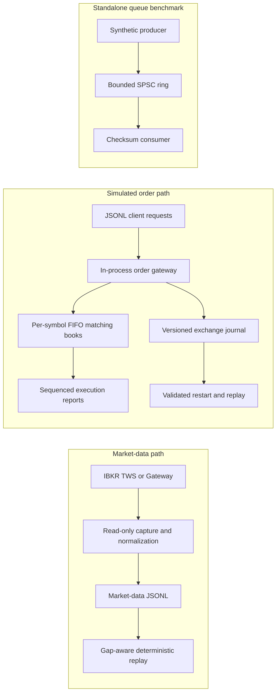

# Equity Matching Engine & Market Replay

**A deterministic Rust exchange simulator and market-data replay lab.** The project combines a FIFO price-time matcher, an in-process multi-client order gateway, an append-only replay journal, a bounded SPSC pipeline, and read-only IBKR market-data capture.

> Portfolio and research software. The IBKR adapter captures data only and does not route orders. Synthetic benchmark results describe the tested workloads and machine; they are not live-market or production-exchange performance claims.

## Why this project

This repository is a hands-on systems project for exploring how exchange-style order handling, deterministic replay, data integrity, and low-latency measurement fit together. It is useful for:

- **Recruiters:** a compact demonstration of Rust systems work, measurable performance, and correctness evidence.
- **Trading-systems and market-data engineers:** a codebase for inspecting FIFO matching, client order lifecycles, event processing, replay, and gap handling.
- **Researchers and students:** a reproducible simulator for experimenting with order behavior and synthetic event workloads without sending real orders.

## At a glance

| Component | What is implemented |
| --- | --- |
| Matching engine | Per-symbol FIFO price-time books using integer ticks and lots |
| Simulated order gateway | In-process JSONL commands, multiple logical clients, ownership checks, idempotent retries, and sequenced reports |
| Order policies | GTC, IOC, FOK, post-only, and cancel-incoming-remainder self-trade prevention |
| Correctness | Independent flat-vector reference matcher, deterministic randomized comparisons, and property-based tests |
| Exchange journal | Versioned append-only JSONL records, checksums, checkpoints, corruption detection, and replay recovery |
| Market data | Normalized L1/L2 records, offline depth replay and gap detection, plus optional read-only IBKR capture |
| Event pipeline | Bounded SPSC processing and synthetic load benchmarks |

## Measured results

These are measured synthetic workloads on Windows x86_64 with an AMD Ryzen 9 9900X release build. Pinning and workload details are in the linked artifacts. The reported service latency is not end-to-end live-market latency.

| Workload | Result | Scope |
| --- | --- | --- |
| Matching core | **5.91M commands/s median; 400 ns p99** | Five pinned trials, 10M fixed-seed mixed submit/cancel commands per trial; one logical CPU. |
| Independent correctness | **100,000 commands; 5 seeds; 0 mismatches** | Production gateway compared command by command with an independently structured reference model; property tests cover generated sequences. |
| Bounded SPSC pipeline | **1.0003-1.0005M events/s; 0 loss; 0.597-0.623 us p99** | Three pinned 10M-event synthetic trials with a checksum consumer; excludes matching and persistence. |
| Parsed gateway with STP | **508.6k requests/s median; 5.0 us p99** | Five pinned trials of 10,000 frozen JSONL requests. Against a same-workload pre-STP baseline, throughput was 5.1% lower and p99 6.4% higher. |
| Gateway plus journal | **119.9k commands/s at 10K; 36.3k/s at 100K** | Schema-v2 checkpoint interval 4,096; five pinned trials per workload. Full-state checks create long tail spikes. |
| Journal replay | **37.6k records/s; 11.6 us p99 at 100K** | Replays and validates the complete journal, then recomputes the final state fingerprint. |

The matcher result supports the synthetic matching-only target of more than 5M commands/s with p99 below 1 us on this machine. The SPSC result applies only to its bounded synthetic queue workload and retry policy. Neither result establishes live IBKR capture capacity. Journal writes flush through the OS file API but do not call `fsync` or `FlushFileBuffers`, so power-loss durability is not claimed.

### Benchmark evidence

- [Exchange, journal, and replay report](benchmarks/exchange-gateway-benchmark-2026-11-10.md) and [raw trials](benchmarks/exchange-gateway-benchmark-2026-11-10.csv)
- [Self-trade-prevention gateway trials](benchmarks/exchange-stp-gateway-2026-11-10.csv)
- [Journal checkpoint scaling report](benchmarks/journal-v2-scaling-2026-11-10.md)
- [Pinned 10M matcher rerun](benchmarks/matcher-10m-pinned-rerun-2026-11-10.csv) and [earlier matcher report](benchmarks/matcher-10m-2026-11-09.md)
- [Pinned SPSC queue report](benchmarks/pinned-spsc-10m-2026-11-09.md)
- [SPSC pipeline optimization report](benchmarks/pipeline-optimization-2026-11-10.md)

## Architecture

The market-data and simulated-order paths are independent. Captured market data does not automatically drive the simulator's order book.



## Exchange behavior

- Best price trades first; equal-price orders execute FIFO at the resting maker's price.
- Cancel removes remaining quantity. Replace is cancel-and-new, so it loses time priority; a rejected replacement leaves the original order live.
- Request IDs are scoped by client. Identical retries return cached reports; reuse with different content is rejected. Cancels and replacements enforce ownership.
- GTC rests any unfilled remainder. IOC cancels the remainder. FOK rejects atomically when visible eligible quantity is insufficient. Post-only rejects a crossing order.
- Self-trade prevention stops before the next same-client maker, keeps that resting order unchanged, and cancels the incoming remainder. External fills earlier in the FIFO walk remain valid.
- Quantity and notional limits are configurable. Execution reports carry a deterministic global sequence and are associated with the relevant client.

Read the [order-handling specification](docs/exchange-order-handling.md) for exact semantics, replay guarantees, and edge cases.

## Quick start

```powershell
cargo build --release
cargo test
cargo run --release -- exchange-sim --input fixtures/exchange-session.jsonl
```

Example request:

```json
{"client_id":7,"request_id":1,"command":{"type":"new","client_order_id":101,"symbol":"AAPL","side":"Buy","price_ticks":19000,"quantity_lots":25}}
```

Prices are integer ticks and quantities are integer lots. The fixture exercises acknowledgements, fills, cancel/replace, and an idempotent retry. Run `exchange-sim` without `--input` to read JSONL requests from standard input. New and replacement orders may set `"time_in_force":"ioc"`, `"time_in_force":"fok"`, or `"post_only":true`; omitted fields default to GTC and non-post-only.

### Persist and recover a session

```powershell
cargo run --release -- exchange-sim --input fixtures/exchange-session.jsonl --journal exchange.jsonl --summary original.json --state-checksum-interval 4096
cargo run --release -- exchange-recover --journal exchange.jsonl --output recovered.json
```

Compare the summaries to verify reconstructed order state, reports, and final checksum. The journal is separate from IBKR market-depth recordings. It detects corrupt entries, sequence gaps, and a truncated final record. The CLI flushes records, but does not promise durability across power loss or an OS/storage failure.

### Optional read-only IBKR capture

Copy `.env.example` to `.env`, start and log in to TWS or IB Gateway, then run:

```powershell
cargo run --release -- ibkr-capture
```

The adapter reads local socket settings from `.env` and writes market-data JSONL under `data/ibkr/`. It does not send orders. Connection, entitlements, and capture completeness must be checked in the user's IBKR environment.

## Reproduce the benchmarks

Matching core, pinned to a logical CPU on Windows:

```powershell
cargo run --release -- benchmark --events 10000000 --seed 20261109 --trials 5 --warmup-events 100000 --core 0
```

Parsed gateway, journal, and replay stages:

```powershell
cargo run --release -- exchange-benchmark --events 10000 --trials 5 --seed 20261110 --core 0
```

Bounded SPSC checksum pipeline:

```powershell
cargo run --release -- pipeline-benchmark --queue spsc --events 10000000 --rate 1005000 --capacity 65536 --trials 3 --producer-core 0 --consumer-core 12
```

The exchange benchmark prints CSV rows. `--core` requests affinity and exits if pinning fails. For the pipeline benchmark, check the pin-success fields and retain the complete output. Compare pinned results with pinned results on the same workload; do not treat an affinity or workload change as an optimization gain.

## Scope and limitations

The order gateway is an in-process JSONL simulator, not TCP, FIX, or a production OMS. The project does not model auctions, fees, venue-specific protocols, network latency, or live order routing. The IBKR path is a read-only capture adapter and has not been qualified as a lossless production feed handler. Synthetic zero-loss results apply only to the tested queue, retry policy, workload, and hardware.

## Built with

Rust, Serde/JSON, `rtrb`, `core_affinity`, `ibapi`, and proptest.
