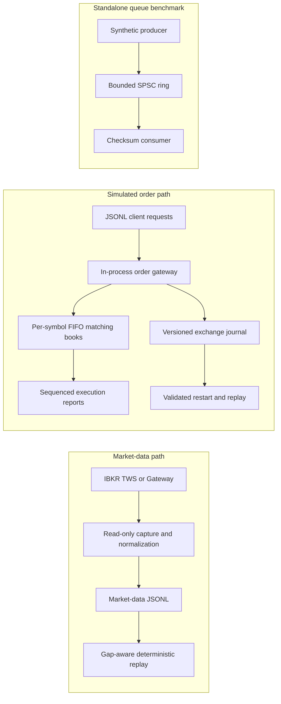

# Equity Matching Engine & Market Replay

**A deterministic, single-process exchange simulator and market-data laboratory written in Rust.** Explore FIFO price-time matching, client order lifecycles, bounded event queues, and replayable market data with repeatable correctness and performance checks.

> This is a research and portfolio project. The IBKR adapter captures market data only; the simulator does not route orders to a broker or exchange. Synthetic benchmark results are not live-market performance claims.

## Project snapshot

| | |
| --- | --- |
| **Language** | Rust 2021 |
| **Core** | FIFO price-time matching with integer ticks and lots |
| **Gateway** | In-process JSONL simulator with multiple logical clients |
| **Replay** | Deterministic event and journal recovery with checksums |
| **Market data** | Provider-neutral L1/L2 types and an optional read-only IBKR capture adapter |
| **Queues** | Bounded blocking and SPSC pipeline benchmarks |
| **Verification** | Unit tests, proptest, independent reference model, fixed-seed benchmarks |

## Measured results

Results below were measured on an AMD Ryzen 9 9900X / Windows x86_64 release build. See the linked reports and raw trial files for exact workload, affinity, timing boundaries, and limitations.

| Area | Result | What the number means |
| --- | --- | --- |
| **Matching core** | **5.91M commands/s median; 400 ns p99** | Five pinned trials of 10M synthetic mixed submit/cancel commands on one logical CPU. |
| **Independent correctness** | **100,000 commands; 5 seeds; 0 mismatches** | Production gateway checked against a deliberately different flat-vector matcher; proptest adds generated sequences. |
| **Bounded SPSC queue** | **1.0003–1.0005M events/s; 0 loss; 0.597–0.623 us p99** | Three pinned 10M-event trials. Consumer computes a checksum; this does not include matching or persistence. |
| **Parsed simulated gateway** | **519.7k requests/s median; 8.7 us p99** | Five frozen-workload trials of 1,000 JSONL requests per trial. Treat as an initial small-workload baseline. |
| **Gateway with journal** | **157.6k requests/s median; 24.1 us p99 at 1K** | Schema v2 checkpoints full state every 4,096 commands by default and validates each replayed command. |
| **Journal scaling** | **119.9k/s at 10K; 36.3k/s at 100K** | Five pinned runs per workload, p99 of 26.8 us / 32.6 us. Full-state checkpoint work still creates rare long maximum-latency spikes. |
| **Journal replay** | **37.6k records/s; 11.6 us p99 at 100K** | Replays and validates the entire journal; final state fingerprint is recomputed. |

The matcher rerun was below an earlier 6.68M/s result, so no speedup is claimed. The journal's measured v2 throughput depends on checkpoint interval and workload size; a full fingerprint per entry reproduces the slower ~1.6K/s baseline. The SPSC result is a simple synthetic queue test, not evidence that the IBKR capture path sustains one million live market events per second. The exchange journal flushes records but does not call `fsync` or `FlushFileBuffers`.

- [Benchmark report and gateway/replay raw trials](benchmarks/exchange-gateway-benchmark-2026-11-10.md)
- [Journal v2 checkpoint scaling and raw trials](benchmarks/journal-v2-scaling-2026-11-10.md)
- [Pinned 10M matcher raw trials](benchmarks/matcher-10m-pinned-rerun-2026-11-10.csv) and [prior matcher run](benchmarks/matcher-10m-2026-11-09.md)
- [Pinned SPSC queue report](benchmarks/pinned-spsc-10m-2026-11-09.md)
- [SPSC telemetry optimization report and paired raw trials](benchmarks/pipeline-optimization-2026-11-10.md)

## What it can be used for

- **Exchange mechanics experiments:** study price-time priority, maker-price fills, partial execution, cancellation, and replacement priority.
- **Order lifecycle and client behavior:** exercise idempotent retries, duplicate IDs, ownership checks, risk limits, and execution reports without placing real orders.
- **Deterministic replay:** reproduce a JSONL session, inspect market-depth gaps, validate a journal after restart, and compare stable state checksums.
- **Low-latency engineering practice:** measure matcher service time and queue behavior under frozen synthetic workloads; compare changes without changing the workload.
- **IBKR market-data development:** capture and normalize read-only Level 1 quotes/trades and positional Level 2 depth from an already-running TWS or IB Gateway session.

## Architecture

The two data paths are independent today; the market-data replay path does not feed the simulated exchange gateway automatically.



## Matching and gateway behavior

- Integer price ticks and quantity lots avoid floating-point comparisons in the matching core.
- Each symbol has an independent book. The best price trades first; orders at the same price trade FIFO. Fills execute at the resting order's price.
- A replace cancels the old order and submits a new client order ID, giving it new time priority. A rejected replacement leaves the old order live.
- Request IDs are scoped to a client. An identical retry returns cached reports; reuse with changed command content is rejected. Client ownership is enforced for cancels and replacements.
- A fill generates sequenced execution reports for both the resting and incoming clients. Quantity/notional risk limits are configurable.
- The journal stores requests, outcomes, checksums, and monotone journal sequence numbers. Recovery rejects sequence gaps, corrupt entries, and a truncated final record.

Full rules and persistence limits are in [the order-handling specification](docs/exchange-order-handling.md).

## Quick start

```powershell
cargo build --release
cargo test
cargo run --release -- exchange-sim --input fixtures/exchange-session.jsonl
```

Example request:

```json
{"client_id":7,"request_id":1,"command":{"type":"new","client_order_id":101,"symbol":"AAPL","side":"Buy","price_ticks":19000,"quantity_lots":25}}
```

Prices are integer ticks and quantities are integer lots. The fixture shows an acknowledgement, partial fill, cancel/replace, full fill, and idempotent retry. Run `exchange-sim` without `--input` to read JSONL from standard input.

### Persist and recover a simulated session

```powershell
cargo run --release -- exchange-sim --input fixtures/exchange-session.jsonl --journal exchange.jsonl --summary original.json --state-checksum-interval 4096
cargo run --release -- exchange-recover --journal exchange.jsonl --output recovered.json
```

Compare the summaries to confirm reconstructed order state, reports, and final checksum. Schema v2 writes a full-state checkpoint every 4,096 commands by default; use `--state-checksum-interval 1` for a full state fingerprint on every record. `--flush-every N` batches writer flushes (default 1). The journal is separate from IBKR market-depth recordings and does not promise power-loss durability.

### Optional IBKR read-only capture

Copy `.env.example` to `.env`, start and log in to TWS or IB Gateway, then run:

```powershell
cargo run --release -- ibkr-capture
```

The adapter uses the local socket settings in `.env` and writes market-data JSONL under `data/ibkr/`. It does not send orders. Actual IBKR connection, entitlements, disk behavior, and capture completeness must be verified in the user's own environment; they are not established by the synthetic tests here.

## Reproduce benchmarks

Matcher core, pinned to a logical CPU on Windows:

```powershell
cargo run --release -- benchmark --events 10000000 --seed 20261109 --trials 5 --warmup-events 100000 --core 0
```

Full simulated gateway, journal, and replay stages:

```powershell
cargo run --release -- exchange-benchmark --events 1000 --trials 5 --seed 20261110 --core 0
```

Bounded single-producer/single-consumer checksum pipeline:

```powershell
cargo run --release -- pipeline-benchmark --queue spsc --events 10000000 --rate 1005000 --capacity 65536 --trials 3 --producer-core 0 --consumer-core 12
```

The exchange benchmark prints CSV rows. `--core` requests thread affinity and exits if pinning fails. For the pipeline benchmark, check the printed pin-success values and preserve the complete CSV output. Do not compare pinned and unpinned runs as if affinity were an optimization.

## Correctness and scope

`cargo test` includes the independent reference comparisons, property-generated command sequences, journal corruption/truncation and recovery cases, and multi-client concurrency tests. The reference matcher intentionally uses a flat order vector and scans for matches, unlike the production matcher's indexed price levels and FIFO queues.

The gateway is in-process JSONL, not TCP, FIX, or a production order-management system. It models limit orders and does not model auctions, fees, venue-specific order types, exchange/network latency, or live order routing. Market-data capture has not been qualified as a lossless production feed handler. The queue benchmark's zero-loss claim applies only to its tested synthetic workload, bounded queue, retry policy, and hardware.

## Built with

Rust, Serde/JSON, `rtrb` SPSC ring buffer, `core_affinity`, `ibapi`, and proptest.
